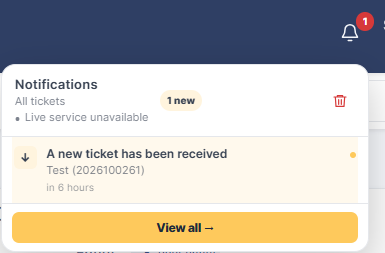
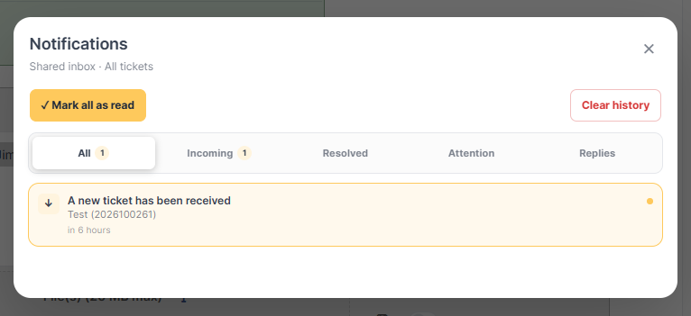
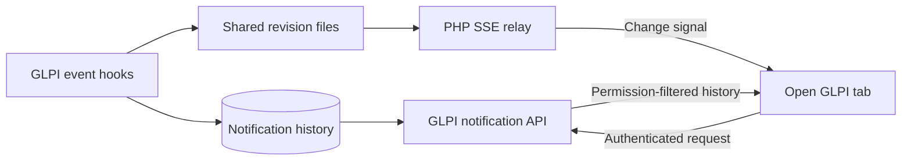

<div align="center">

# 🔔 NotificationBell for GLPI

**Your tickets. Your teams. One place to stay informed.**

Profile-aware inboxes, personal and team mentions, and live updates—right inside GLPI.


[](LICENSE)

**All · Incoming · Resolved · Attention · Replies**

[Preview](#-preview) · [Features](#-features) · [Requirements](#-requirements) · [Installation](#-installation-and-updates) · [Live updates](#-live-updates) · [Development](#-development)

</div>

---

## ✨ Features

| Feature | What it does |
| --- | --- |
| **An inbox for your active profile** | Routes notifications to a global inbox, your team's inbox, or your personal requester inbox using GLPI's effective permissions. |
| **Incoming at a glance** | Shows one arrival per ticket or Change in the authorized shared inbox. Self-Service receives no arrival notifications. |
| **Status transitions** | Sends ticket processing/pending transitions and every native Change status transition to Attention for Service Desk and linked technical areas. |
| **Personal and team mentions** | Distinguishes public replies, native GLPI user mentions, and `@area` mentions. |
| **Live updates** | Uses a standalone PHP Server-Sent Events (SSE) relay to refresh notifications without reloading the page. |
| **Automatic fallback** | Polls every 10 seconds in visible tabs when live delivery is unavailable, with backoff after failures. |
| **Explicit read controls** | Marks notifications as read when you open their ticket or select **Mark all as read**. |
| **Attention reminders** | Flags active or pending tickets that have not changed for at least 24 hours. |
| **Theme and language support** | Follows GLPI's active palette and the user's language, with English and Spanish interface text. |

The bell provides a five-item preview and a full history with up to **1,000 recent notifications** combined across the selected shared inbox and eligible personal notifications. The unread counter also includes authorized unread notifications older than that history limit.

The limits apply after permissions, category filtering and arrival deduplication. Hidden records do not displace eligible older notices. Distinct status updates remain separate even within the same second, while repeated callbacks for one update remain deduplicated.

Each notification includes the ticket title and numeric ID, so you can identify the ticket before opening it.

## 🖼️ Preview

### Recent notifications at a glance

Open the bell to check recent activity, the unread count, and the live connection status. Select **View all** to open the full history.

<p align="center">
  
</p>

### Full history and read controls

Browse **All**, **Incoming**, **Resolved**, **Attention**, and **Replies**, with **Mark all as read** and **Clear history** controls in the same window.

<p align="center">
  
</p>

The screenshots show the English interface. Labels follow the user's GLPI language, and colors follow the active palette.

## 📋 Requirements

The following combinations are accepted by the plugin's [compatibility check](setup.php):

| Component | Supported configuration |
| --- | --- |
| **GLPI 11** | **11.0.0–11.0.11** with **PHP 8.2+**. |
| **GLPI 12** | **12.0.0** with **PHP 8.3+**. |
| **Live relay** | **PHP CLI 8.2+**. No Node.js, npm, Docker, Redis, or database credentials are required for the relay. |
| **Deployment examples** | Linux, systemd, and a reverse proxy on the same origin as GLPI; use HTTPS for deployment. |
| **Attention reminders** | GLPI's external cron must run the hourly `AttentionReminders` task. |
| **User mentions** | Mentions enabled in the GLPI profile and a user selected through GLPI's rich-text editor. |

These are declared compatibility ranges, not certification of every GLPI release through live integration tests. GLPI 11.0.12 and GLPI 12.0.1 are outside the current accepted ranges.

The plugin loads an additional dark-surface compatibility stylesheet for GLPI 11 and uses native palette variables on GLPI 12. The bell, history, and confirmation dialogs follow palette changes made in user preferences.

## 🧭 How inboxes work

### Your active profile determines your inbox

NotificationBell reads the effective capabilities of the **currently active GLPI profile**. Permissions from other profiles are not combined. Group membership is retrieved through `Group_User::getUserGroups()`, so newly created groups and custom profiles do not need a hardcoded routing list.

| Profile behavior | Visible scope |
| --- | --- |
| **Self-Service** | Personal replies, mentions and resolution notices for requester-owned tickets; no arrival notifications. |
| **Global access** | Eligible notifications across tickets the user can read, including tickets with no assigned group. |
| **Assigned-area access** | Tickets assigned to the user's groups that have `is_assign = 1`. |
| **Requester/observer group access** | Tickets linked as requester or observer to the user's groups that have `is_requester = 1` or `is_watcher = 1`. |

<details>
<summary><strong>Exact capability routing</strong></summary>

The checks run in this order:

1. A profile using the `helpdesk` interface receives the Self-Service view.
2. `READALL` combined with `ASSIGN`, or `READALL` without `OWN`, selects the global inbox.
3. Otherwise, `OWN` or `READASSIGN` selects assigned-area access.
4. Otherwise, `READGROUP` without `READMY` selects requester/observer group access. The basic `READMY` + `READGROUP` combination remains personal.
5. Remaining profiles fall back to Self-Service unless they qualify for global reading.

Every notification is still subject to current item read permissions and entity access. Change notifications use `Change::can()` and Change group relations, independently of ticket IDs and ticket rights. These rules select the inbox; they do not grant additional GLPI privileges.

</details>

The global inbox is created automatically. No Service Desk group IDs or profile names need to be configured.

### Five tabs, one consistent permission model

| Tab | Contents |
| --- | --- |
| **All** | All notifications available to the current profile and selected inbox. |
| **Incoming** | One arrival per ticket or Change, filtered by the user's profile and item/group permissions. Excluded from Self-Service, including retained personal arrivals and the badge. |
| **Resolved** | Ticket resolution notifications. |
| **Attention** | Immediate ticket transitions to Processing (assigned), Processing (planned), or Pending; every native Change status transition; and 24-hour ticket reminders for eligible linked areas. |
| **Replies** | Public replies, personal `@` mentions, and area `@` mentions, with distinct titles. |

Attention reminders are excluded from the global inbox, requester personal inboxes, and groups named **Service Desk** or **Mesa de Servicios**. This name-based exception applies to reminders; profile routing itself uses capabilities. The hourly task limits reminders to one every 24 hours per group and ticket, based on the retained history.

Immediate status notifications reach both Service Desk and the assigned technical areas; they do not wait for cron. Their titles include the destination state in the viewer's language. Changes cover New (on reopening), Evaluation, Approval, Accepted, Pending, Testing, Qualification, Applied, Review, Closed, Cancelled and Refused, using GLPI's own status catalog. Creation remains in Incoming. Change replies and mentions are outside this feature.

### Reading and clearing notifications

- **Opening the bell or history does not mark notifications as read.** Open a notification's ticket or use **Mark all as read**.
- **Group and global inboxes share their read state.** Personal mentions and Self-Service notifications have individual read and deletion state.
- **Mark all as read** affects accessible notifications in the selected inbox and eligible personal notifications.
- **Clear history** opens a confirmation dialog. A trash button is also available in the quick preview.

> [!WARNING]
> **Clear history deletes stored notifications.** It clears every record in the selected shared inbox and the current user's personal inbox, including notifications for tickets the user can no longer read. It affects other members of that shared inbox, but does not clear other group inboxes or other users' personal inboxes. In the personal-only view, it clears only the current user's personal inbox.

## 💬 Mentions that reach the right recipient

### Mention a person

Type `@` in GLPI's rich-text editor and **select the intended user from the native selector**. GLPI stores a structured mention with a user ID; NotificationBell resolves that ID and checks that the account exists and is active.

Typing a person's name as plain text does not create a personal mention. Identity is determined by the selected user ID, so matching display names do not redirect the notification.

Mentions are supported in ticket descriptions, followups, tasks, and solutions. Edits are reconciled, removed mentions are withdrawn, and notifications are removed when their source is deleted.

### Mention an area

Write `@` followed by the name of a group linked to the ticket. The plugin matches the group's name or full name among the ticket's involved groups and places the area mention in **Replies**.

For a public reply, an explicitly mentioned recipient receives the specific mention notification instead of the generic reply notification for that recipient.

### Visibility and private content

The recipient must be within the active profile's ticket scope and be allowed to read both the ticket and the mention's source. Self-Service users only see mentions on tickets where they are also requesters.

Private notes do not generate shared inbox notifications. Personal mentions inside private content remain subject to the source item's read permissions. Public reply notifications are withdrawn if the reply becomes private or is deleted.

## 🚀 Installation and updates

### Install the plugin

1. Extract the production archive `notificationbell-1.1.0.zip` into `GLPI_ROOT/plugins/`. The archive contains one top-level folder named **`notificationbell/`**.
2. Install and activate **Notification bell** from GLPI's plugin administration, or run the following from the GLPI root:

   ```bash
   php bin/console plugin:install notificationbell --force --username=glpi
   php bin/console plugin:activate notificationbell
   ```

3. Configure the optional [live relay](#-live-updates) for SSE delivery. Without it, the bell uses polling.
4. Reload existing GLPI tabs once to load **`bell-live10.js`**. Subsequent events can then update the interface without a page refresh.

Replace `glpi` with an appropriate administrator username for your installation. If working from source, build the archive with `php tools/package.php`; it is written to `dist/notificationbell-1.1.0.zip`.

### Update an existing installation

Deactivate the plugin, preserve any local modifications, and replace its directory with the clean folder from the new archive so obsolete files are removed. Run the installation commands above to apply migrations and reactivate it.

> [!IMPORTANT]
> **Do not uninstall the plugin to update it.** Updating preserves existing shared notifications and external relay configuration. Uninstalling deletes notification history.

| Database change | Update behavior |
| --- | --- |
| `glpi_plugin_notificationbell_group_notifications` | Preserved; the migration adds `is_incoming` and marks previous assignment notifications for Incoming. |
| `glpi_plugin_notificationbell_user_notifications` | Created for personal notifications and mentions. |
| `glpi_plugin_notificationbell_notifications` | Legacy table retained, but its contents are not imported or displayed. |

## ⚡ Live updates

The included relay runs independently as a PHP CLI process supervised by systemd. It signals that an inbox changed; GLPI remains responsible for identity, permissions, and notification history.



### Apache: interactive installer

From the actual `plugins/notificationbell` directory, review the deployment first:

```bash
sudo bash service/install-sse-apache.sh --dry-run
```

Then install:

```bash
sudo bash service/install-sse-apache.sh
```

The script asks for the real GLPI path, origin URL, Apache VirtualHost, configuration and files directories, web user, service name, and local port. It does not assume `/var/www/html/glpi`.

The dry run does not create files or restart services. The installer checks prerequisites, creates the shared configuration, installs the PHP relay service, and configures the same-origin proxy. Existing SSE configurations are not overwritten. VirtualHost files with CRLF line endings are supported.

See the [full Apache setup guide](service/SSE_APACHE.md) for VirtualHost requirements, SELinux configuration, options, validation, and rollback behavior. For available command-line options:

```bash
bash service/install-sse-apache.sh --help
```

<details>
<summary><strong>Nginx: manual configuration</strong></summary>

The files in `service/` are templates. Replace the sample web user, PHP CLI path, GLPI path, and origin with your actual installation values before enabling the service.

**1. Prepare directories and generate a secret.** The commands below use `www-data` as an example:

```bash
sudo install -d -o www-data -g www-data -m 0750 /var/lib/notificationbell
sudo install -d -m 0750 /etc/notificationbell
openssl rand -hex 32
```

**2. Configure the GLPI bridge.** Copy [`service/notificationbell.config.php.example`](service/notificationbell.config.php.example) to **`GLPI_CONFIG_DIR/notificationbell.php`**. Use GLPI's actual configuration directory, outside the public web root, with read access restricted to the administrator and web user:

```php
<?php
return [
    'state_dir' => '/var/lib/notificationbell',
    'url' => '/notificationbell-live/events',
    'secret' => 'REPLACE_WITH_THE_GENERATED_RANDOM_SECRET',
];
```

**3. Configure the relay environment.**

```bash
sudo install -m 0600 service/relay.env.example /etc/notificationbell/relay.env
sudoedit /etc/notificationbell/relay.env
```

| Setting | Value |
| --- | --- |
| `NB_SECRET` | The **same secret** used in the PHP configuration. |
| `NB_ORIGIN` | The exact GLPI origin, such as `https://glpi.example.org`, without a path or trailing slash. |
| `NB_STATE_DIR` | The same shared revision directory used by `state_dir`. |
| `NB_PORT` | Local listening port; the example uses `8091`. |

Placeholder secrets beginning with `REPLACE_` are rejected. The web PHP process must be able to write revision files, and the relay must be able to read them. All PHP nodes must share this directory in a multi-node deployment.

**4. Configure the proxy.** Add [`service/nginx.conf.example`](service/nginx.conf.example) to the HTTPS server block serving GLPI. Keep streaming unbuffered, disable caching, and exclude the query string from access logs because it carries a short-lived signed capability. If a Content Security Policy is configured, allow `connect-src 'self'`.

Keep the relay bound to loopback. Browsers connect through the proxy on GLPI's origin.

**5. Install the service.** Edit [`service/notificationbell.service`](service/notificationbell.service) first: replace `User`, `Group`, and the PHP and plugin paths in `ExecStart`. Then run:

```bash
sudo install -m 0644 service/notificationbell.service /etc/systemd/system/notificationbell.service
sudo systemctl daemon-reload
sudo systemctl enable --now notificationbell
sudo nginx -t
sudo systemctl reload nginx
sudo systemctl status notificationbell --no-pager
sudo journalctl -u notificationbell -n 30 --no-pager
```

</details>

### Delivery, recovery, and limits

| Behavior | Details |
| --- | --- |
| **Transport** | Hooks save notifications to MySQL and write a random revision per group or user. The relay checks revisions every second and emits `changed` only to authorized signed channels. |
| **Data separation** | The relay does not read MySQL or carry ticket titles, ticket IDs, message bodies, or GLPI sessions. The browser fetches notification data from GLPI's authenticated API. |
| **Authorization** | HMAC capabilities last 120 seconds and renew before expiry. Every API read rechecks the session, membership, and permissions. |
| **Write protection** | Mutations require POST. GLPI 11 uses a CSRF token; GLPI 12 uses its front controller's origin checks. |
| **Recovery** | Every connection or reconnection synchronizes history. Notifications remain stored if the relay is unavailable. |
| **Fallback** | Visible tabs poll every 10 seconds when live delivery is unavailable. Failures use backoff; returning to the tab, focusing it, or reconnecting triggers an immediate refresh. Reads do not prolong the PHP session. |
| **Status indicator** | Shows **Live**, **Reconnecting**, or **Live service unavailable**. |

The transport targets roughly one second plus API and browser processing time; this is not a latency guarantee under load.

A GLPI tab and a valid session are required. SSE can remain connected in hidden tabs, subject to browser or operating-system suspension. There are no operating-system notifications with the browser closed.

The relay operates outside GLPI web requests and automatic tasks, but still depends on GLPI hooks to produce events. It does not detect direct SQL changes that bypass those hooks. The hourly **`AttentionReminders`** cron remains necessary for 24-hour reminders.

### Verify the deployment

1. Create a ticket from another session and verify that it appears in **Incoming** for a profile with global access, without reloading.
2. Assign it to a technical group and check the appropriate group's notifications and filters.
3. Switch to a Self-Service profile and verify that only requester-owned tickets are shown.
4. Mention a user through GLPI's native selector and verify that the personal mention reaches that user, not another account.
5. Restart the relay and verify that the connection recovers and the history synchronizes.

## 🛠️ Development

<details>
<summary><strong>Project structure</strong></summary>

| Path | Responsibility |
| --- | --- |
| [`setup.php`](setup.php), [`hook.php`](hook.php) | Version checks, asset registration, GLPI hooks, table migrations, and uninstall. |
| [`inc/notification.class.php`](inc/notification.class.php) | Profile routing, Incoming, mentions, privacy, read actions, and reminders. |
| [`inc/realtime.class.php`](inc/realtime.class.php) | External configuration, revision files, and signed connection capabilities. |
| [`front/notifications.php`](front/notifications.php) | Authenticated JSON API and version-specific request protection. |
| [`public/js/bell-live10.js`](public/js/bell-live10.js) | Registered browser entry point: bell, history, SSE connection, and recovery. |
| [`public/css/bell-palette.css`](public/css/bell-palette.css) | Palette-aware interface styling. |
| [`public/css/bell-palette-glpi11.css`](public/css/bell-palette-glpi11.css) | Additional GLPI 11 dark-surface compatibility. |
| [`service/`](service/) | PHP CLI relay, Apache installer, and deployment templates. |
| [`locales/`](locales/) | Compiled Spanish catalogs. The translation source stays in the repository. |
| [`tools/`](tools/) | Translation compilation and packaging. |

</details>

<details>
<summary><strong>Translations and production package</strong></summary>

```bash
python3 tools/compile_locales.py
php tools/package.php
```

Packaging requires PHP's `zip` extension. [`tools/package.php`](tools/package.php) reads the version from `setup.php`, builds `dist/notificationbell-1.1.0.zip`, verifies every archived file against its source SHA-256, and writes a companion `.sha256` file.

The production archive includes the PHP relay, deployment files, the README, and screenshots. Tests, developer tools, Git metadata, and external private configuration are excluded.

</details>

## 🗑️ Uninstallation

Deactivation disables the plugin without deleting its history. **Uninstalling** through GLPI deletes the current group and personal tables and the legacy table, including their notification histories.

Stop and disable the external relay separately:

```bash
sudo systemctl disable --now notificationbell
```

GLPI does not manage system services. External configuration, proxy rules, and the revision directory must be managed separately.

## 📄 License

Developed by [Kaztled](https://github.com/Kaztled). Distributed under **GNU GPL v3 or later**, as declared in the plugin metadata. See [LICENSE](LICENSE).
