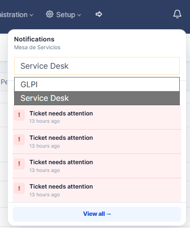
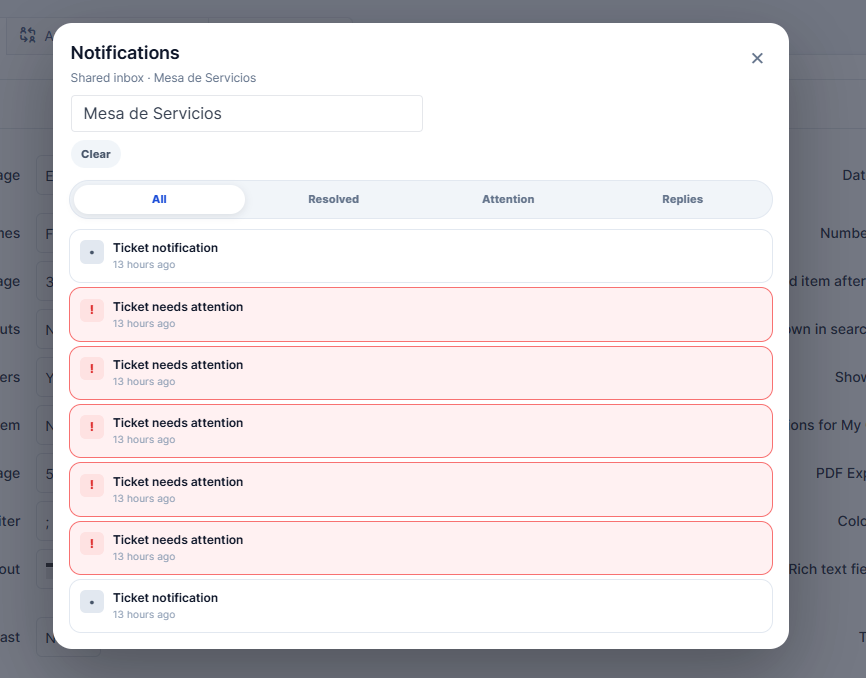

<div align="center">

# 🔔 NotificationBell for GLPI

**Stay on top of your tickets in one click.**

A notification bell with shared group inboxes, filterable history, and attention reminders, built into GLPI 11.


[](LICENSE)

[Preview](#-preview) · [Features](#-features) · [Installation](#-installation) · [Usage](#-usage) · [Development](#-development)

</div>

## ✨ Features

| Feature | What it offers |
| --- | --- |
| **Integrated bell** | Access next to the user menu in both horizontal and vertical GLPI headers. |
| **Quick view** | The five most recent notifications for the selected group and an unread counter. |
| **Group inboxes** | A selector to switch between the GLPI groups you belong to. |
| **Filterable history** | **All**, **Resolved**, **Attention**, and **Replies** tabs. |
| **Ticket access** | Links from notifications to their related tickets. |
| **Automatic reminders** | Notifications for pending or active tickets with no changes for at least 24 hours. |
| **Periodic updates** | Checks about every 60–65 seconds in visible tabs, with pauses and backoff to limit traffic. |
| **Languages** | Interface text and titles follow the user's language, with Spanish translations and English source text. |

## 🖼️ Preview

### Notifications without leaving your work

Open the bell to review recent activity and switch between your groups. Select **View all** to open the notification history.

<p align="center">
  
</p>

### History organized by notification type

Browse your group's notifications and filter tickets that need attention, resolved tickets, or public replies.

<p align="center">
  
</p>

> The screenshots show the English interface. Labels follow the active language in GLPI; group names and ticket content retain their original text.

## 📋 Requirements

| Component | Requirement |
| --- | --- |
| **GLPI** | **11.0.0** through **11.0.11** (`>= 11.0.0` and `< 11.0.12`). |
| **PHP** | **8.2** or later. |
| **User** | Membership in a GLPI group and permission to view the relevant tickets. |
| **Reminders** | A working GLPI external cron setup to run the `AttentionReminders` task. |

The compatibility range is declared and enforced in [`setup.php`](setup.php).

## 🚀 Installation

1. Download the production release ZIP, or clone this repository for development.
2. Name the plugin folder **`notificationbell`** and place it inside `GLPI_ROOT/plugins/`.
3. In GLPI, go to **Setup → Plugins**, then install and activate **Notification bell**.
4. Reload the page. The bell will appear next to the user menu.

The directory structure should look like this, without an extra nested folder:

```text
GLPI_ROOT/
└── plugins/
    └── notificationbell/
        ├── setup.php
        ├── hook.php
        ├── front/
        ├── inc/
        ├── locales/
        └── public/
```

<details>
<summary><strong>Command-line installation</strong></summary>

From your GLPI installation root (`GLPI_ROOT`), run:

```bash
git clone https://github.com/Kaztled/NotificationBell-GLPI.git plugins/notificationbell
php bin/console plugin:install notificationbell --username=glpi
php bin/console plugin:activate notificationbell
```

Replace `glpi` with an administrator username from your installation if needed. Run these commands as the system user responsible for managing your GLPI files.

</details>

### Attention reminders

Installation registers **`AttentionReminders`** to run **every hour** in external execution mode. Make sure GLPI's external cron is running so these reminders can be generated.

The task looks for pending or active tickets that have not changed for at least 24 hours. It limits reminders to one every 24 hours per group and ticket, based on the retained notification history.

## 🧭 Usage

1. **Open the bell** to view the five most recent notifications.
2. **Select a group** if you belong to more than one.
3. **Click View all** to open the history and use its filters.
4. **Open a ticket** from the link in its notification.
5. Use **Mark all as read** or **Clear** to manage the group's notifications.

> [!IMPORTANT]
> **Each group shares an inbox.** Opening the bell or the history automatically marks accessible notifications in the selected group as read. Reading or clearing notifications affects all group members. Each action is limited to notifications for tickets the current user can view.

### Which events generate notifications?

| Event | Recipient groups | Filter |
| --- | --- | --- |
| A ticket is assigned to a group | The assigned group. | All |
| A ticket is resolved | Groups assigned to the ticket. | Resolved |
| A ticket is reopened from resolved to new | Groups assigned to the ticket. | All |
| A solution is rejected | Groups assigned to the ticket. | All |
| A new public reply is added | Requester, assigned, or observer groups on the ticket. | Replies |
| A pending or active ticket has no changes for at least 24 hours | Groups assigned to the ticket. | Attention |

**All** also includes notifications from every other category. Private notes do not generate notifications. If a public reply becomes private or is deleted, its shared notifications are removed.

### Permissions, languages, and history

- **GLPI access checks:** group membership and ticket read permissions are checked when displaying notifications and performing actions on them.
- **Dynamic groups:** groups are retrieved from GLPI by ID; no group names are hardcoded.
- **New events:** the plugin records activity after activation, without importing previous history. Reminders may include existing tickets that meet the conditions.
- **History limit:** up to 1,000 recent group notifications are retrieved and filtered by permissions. The unread counter also includes older unread notifications the user can view.
- **Translations:** catalogs for the Spanish variants available in `locales/` are included. Titles of older notifications are also translated when viewed; English source text is used when a catalog is unavailable.
- **Native integration:** notifications come from GLPI events. The interface takes inspiration from the `managerv2` notification window, but does not require or query that plugin.

### Periodic updates, sessions, and service load

The badge updates automatically without opening the bell. Each visible tab schedules one check 60–65 seconds after the previous request finishes. Hidden tabs and offline browsers pause checks; returning to an overdue visible tab refreshes once. A single initialization guard prevents duplicate header layouts or compatibility scripts from creating extra pollers in the same page.

Background checks return up to five accessible notifications and the complete authorized unread count. The full history is returned while its dialog is open. History selection remains capped at 1,000 candidates, and the exact unread count still checks permissions on each distinct ticket with unread notifications; large inboxes should be measured on the target server.

Requests have a 15-second client timeout and are serialized with user actions. Failures delay the next check by 2, 4, 8, and then 15 minutes; HTTP `Retry-After` can extend that delay. A successful request restores the usual interval. A rejected group selection immediately removes cached notifications before trying the one-time fallback, even if that fallback fails. Session expiry, access denial after the fallback, or an unavailable plugin stops further requests until reload. Errors appear in the dropdown and history. Successful checks do not create plugin application log entries. Normal web-server access logging still records HTTP requests.

GET checks authenticate through GLPI, then call [`session_abort()`](https://www.php.net/manual/en/function.session-abort.php) to release the PHP session without saving bootstrap changes or refreshing file-session activity. POST actions retain GLPI's normal session persistence and require its CSRF token. The endpoint remains protected by GLPI's session, firewall, and CSRF checks. Actual expiry continues to follow the server's session policy.

Notification-save failures produce at most one sanitized plugin error per request. GLPI's shared cache additionally suppresses repeats for 15 minutes, on a best-effort basis across concurrent requests. When that cache is unavailable, the per-request limit remains. Raw exception messages, SQL, and ticket content are excluded from these plugin error messages; GLPI and web-server logging retain their own policies.

## 🔄 Updates and data

Replace the files in `plugins/notificationbell/` with the new version. Then, from `GLPI_ROOT`, run:

```bash
php bin/console plugin:install notificationbell --force --username=glpi
php bin/console plugin:activate notificationbell
```

Reload open GLPI pages after updating so they load `bell.v3.js` and replace any older polling code already running in the browser.

The installation uses the `glpi_plugin_notificationbell_group_notifications` table for shared inboxes.

When upgrading from **1.0.0**, the legacy per-user table remains intact, but its notifications **are not migrated or displayed** in group inboxes.

> [!WARNING]
> Uninstalling the plugin deletes both the current table and the legacy per-user table, along with their notification histories.

## 🛠️ Development

<details>
<summary><strong>Project structure</strong></summary>

| Path | Responsibility |
| --- | --- |
| [`setup.php`](setup.php) | Version, compatibility, assets, and GLPI hooks. |
| [`hook.php`](hook.php) | Installation, database table, automatic task registration, and uninstallation. |
| [`inc/notification.class.php`](inc/notification.class.php) | Events, reminders, recipients, translations, and permissions. |
| [`front/notifications.php`](front/notifications.php) | Authenticated JSON API; mutations require POST and a CSRF token. |
| [`public/js/bell.v3.js`](public/js/bell.v3.js) | Bell, dropdown, history, and periodic updates with visibility pauses and backoff. |
| [`public/css/bell.css`](public/css/bell.css) | Interface styles. |
| [`public/js/bell.js`](public/js/bell.js) | Compatibility bridge for pages still using the previous asset path. |
| [`public/js/bell.v2.js`](public/js/bell.v2.js) | Compatibility bridge to the current client. |
| [`locales/`](locales/) | Source catalog and compiled Spanish translations. |
| [`tests/`](tests/) | Isolated PHP and JavaScript tests. |
| [`tools/package.php`](tools/package.php) | Builds and verifies a production ZIP with a SHA-256 checksum. |
| [`images/`](images/) | Screenshots used in this README. |

</details>

<details>
<summary><strong>Tests and checks</strong></summary>

From the plugin directory, with PHP and Node.js available:

```bash
php tests/notification_test.php
php tests/endpoint_test.php
php tests/log_test.php
node tests/bell_test.js
node tests/polling_test.js
php -l setup.php
php -l hook.php
php -l inc/notification.class.php
php -l front/notifications.php
node --check public/js/bell.v3.js
```

To check the translation catalog on Linux with GNU gettext installed:

```bash
msgfmt --check-format locales/es_MX.po -o /dev/null
```

The PHP tests use local GLPI test doubles and are not loaded in production. These checks do not replace integration testing within a GLPI installation.

</details>

### Production package

From the plugin directory, with PHP's `zip` extension enabled:

```bash
php tools/package.php
```

This creates `dist/notificationbell-1.0.0.zip` and its `.sha256` checksum. The archive contains one `notificationbell/` directory with the plugin, translations, README, license, and screenshots. Tests, simulated GLPI objects, packaging tools, Git metadata, and local output are excluded. Every archived file is read back and checked against its source SHA-256 hash.

Extract `notificationbell/` into `GLPI_ROOT/plugins/`, then follow the installation or update steps above. Keep `tests/` in the development checkout to verify permissions, shared inbox behavior, session handling, and polling. The two legacy JavaScript URLs remain compatibility bridges for cached pages.

## 📄 License

Developed by [Kaztled](https://github.com/Kaztled). Distributed under **GNU GPL v3 or later**, as declared in the plugin metadata. See [LICENSE](LICENSE).
